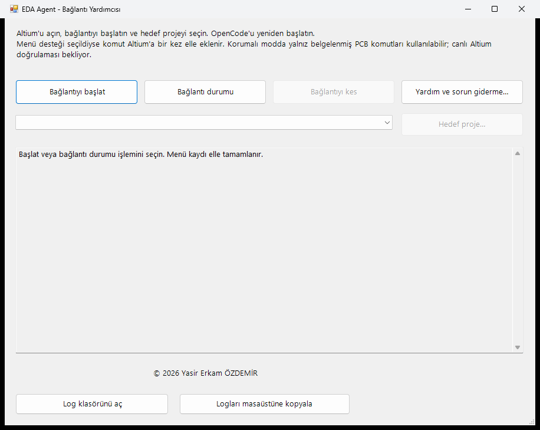

# EDA Agent kullanım kılavuzu

Bu kılavuz, hazır Windows kurulum paketini kullanarak OpenCode üzerinden
Altium Designer veya KiCad'e bağlanmak içindir. Paket üretmek ya da Python
komutları çalıştırmak gerekmez.

## İlk 5 dakika

1. OpenCode, EDA uygulaması ve erişilebilir model hazırsa aşağıdaki tablodan
   doğru paketi seçin; [kurulum adımlarını](#2-kurulum) uygulayın.
2. Altium için bağlantı yardımcısını açın; KiCad için PCB Editor'da API
   sunucusunu etkinleştirin. İki durumda da kullanacağınız kartı açın.
3. OpenCode'u yeniden başlatın ve [ilk bağlantı kontrolünü](#3-i%CC%87lk-bağlantı)
   yapın. Ping yanıtı ve açık kart bilgileri eşleşmeden tasarımı değiştirmeyin.

Bu kısa rota hazır EXE içindir; OpenCode/model kurulumu ve sorun çözümü daha
uzun sürebilir. Tam kurulum akışı bu kılavuzda, tanılama adımları yalnız
[bağlantı doğrulama rehberinde](baglanti-dogrulama.md) tutulur.

## Sürüm kapsamı ve doğrulama durumu

Bu kılavuzun temel aldığı kaynakta `Build-Installer.ps1` varsayılan kurulum
sürümü **0.1.6**, `release-source.json` Python sürümü **3.13.16** ve upstream
EDA Agent commit'i **`f552f69175bea93c6f53571021852de43f05447f`** olarak kayıtlıdır.
Kurulum sürümü, Python sürümü ve upstream commit birbirinden farklı bilgilerdir;
bu değerler bir Release'in yayımlandığını kanıtlamaz. Elinizdeki paketin sürümünü
ve varsa `bundle.json` metadata dosyasını esas alın; eski paketlerde bu kaynak
ağacındaki seçenekler bulunmayabilir.

Gerçek Altium/KiCad bağlantısı hedef bilgisayarda doğrulanmalıdır. İsteğe bağlı
Altium menüsünün canlı sürüm uyumluluğu ve davranışı henüz doğrulanmadı;
menü modu varsayılan olarak kapalıdır. Aşağıdaki yardımcı başlangıç ekranı
arayüzü gösterir; başarılı canlı EDA bağlantısının kanıtı değildir.

## 1. Gereksinimler ve paket seçimi

- Windows 10/11 x64.
- Ayrı kurulmuş OpenCode ve lisans/kurulum gereksinimleri karşılanmış EDA uygulaması.
- OpenCode'da yapılandırılmış, erişilebilir bir model. İnternetsiz bilgisayarda
  yerel veya kurum içi model gerekir; bu paket model veya OpenCode içermez.

| Kullandığınız uygulama | Seçilecek kurulum EXE'si | OpenCode bağlantı adı |
| --- | --- | --- |
| Altium Designer | Adı `-altium.exe` ile biten paket | `eda-agent` |
| KiCad 9 veya üzeri | Adı `-kicad.exe` ile biten paket | `eda-agent-kicad` |

İki paket birlikte kurulabilir. Altium/KiCad uygulamaları pakete dahil değildir.
Kurulum sırasında internet, Python, pip veya Git gerekmez.

## 2. Kurulum

1. Uygun EXE dosyasını hedef bilgisayara taşıyın. Kurulum veya güncelleme öncesi
   OpenCode'u ve Altium kullanıyorsanız Altium'u kapatın.
2. EXE'yi açın, sihirbaz dilini ve kurulum dizinini seçin.
3. **EDA Agent'ı OpenCode'a otomatik ekle** seçeneğini açık bırakın.
4. Altium için ilk kullanımda isteğe bağlı **Altium menü komutunu hazırla**
   seçeneğini kapalı bırakabilirsiniz. Bu özellik tüm araçları desteklemez ve
   canlı Altium doğrulaması beklemektedir; gerekiyorsa
   [menü kullanım belgesini](altium-menu-usage.md) okuyun.
5. Kurulumu tamamlayın ve aşağıdaki uygulamanıza uygun adımları izleyin.

## 3. İlk bağlantı

Kurulumdan sonra [bağlantı doğrulama rehberinde](baglanti-dogrulama.md)
uygulamanıza uygun bölümü izleyin:

- [Altium Designer](baglanti-dogrulama.md#altium-designer): PCB'yi açın ve
  **EDA Agent for Altium → Altium Bağlantı Yardımcısı** üzerinden bağlantıyı
  başlatın. Korumalı menü modu açıksa hedef proje seçimi ve farklı okuma
  araçları gerekir.
- [KiCad](baglanti-dogrulama.md#kicad): KiCad 9+ PCB Editor'da kart açıp
  **Preferences → Plugins → KiCad API server** seçeneğini etkinleştirin.
  Altium scripti veya yardımcısı gerekmez.

*Gerçek bağlantı yardımcısının geçici bir klasörde açılmış başlangıç ekranı;
menü modu kapalıdır. Bu görüntü başarılı EDA bağlantısının kanıtı değildir.
Bu belge hazırlığında çalışan Altium/KiCad oturumu bulunmadığından başarılı
bağlantı veya KiCad API ayarı ekran görüntüsü sunulmuyor.*

OpenCode'u yeniden başlatın; ilgili rehberdeki salt okunur istekleri gönderin.
Ping yanıtı ve açık PCB'nin bilgileri eşleşmelidir; yalnız MCP'nin bağlı
görünmesi yeterli değildir. Başarısızlıkta tasarımı değiştirmeden aynı rehberin
[sorun giderme bölümünü](baglanti-dogrulama.md#sorun-giderme) izleyin.

## 4. Günlük kullanım

1. EDA uygulamasında doğru PCB'yi açın ve etkinleştirin.
2. Altium'da her yeni oturum için bağlantıyı başlatıp durumu kontrol edin.
   Korumalı menü modunda hedef projeyi de yeniden seçin. KiCad'de API sunucusunun
   açık olduğundan emin olun.
3. OpenCode'da doğru bağlantı adını belirterek önce salt okunur bir istek gönderin:

   > Açık PCB'nin bileşenlerini ve netlerini özetle. Yalnız oku;
   > hiçbir bileşeni taşıma, belgeyi değiştirme veya kaydetme.

4. Tasarımı değiştiren bir işlem istemeden önce çalışmanızı kaydedin ve yedeğini
   alın. İstediğiniz değişikliği ve hedef kartı açıkça belirtin; sonucu EDA
   uygulamasında inceleyin. Doğal dildeki istek bir güvenlik sınırı değildir.

Varsayılan `minimal` modda araçlar tek tek görünmeyebilir. Model araçları
`tool_catalog` ile keşfedip `tool_invoke` ile çağırır; bu durum bağlantı hatası
anlamına gelmez. [MCP bağlam ayarı](mcp-context.md) belgesi ayrıntıları açıklar.
Korumalı Altium menü modu yalnız belgelenen araçları çalıştırır; `full` araç moduna
geçmek bu kısıtlamayı kaldırmaz.

Çevrimdışı ortamda internet gerektiren model, parça veya datasheet arama işlemleri
çalışmayabilir. Model erişimi ile EDA bağlantısı ayrı kontrol edilmelidir.

## 5. Sorunlar, güncelleme ve kaldırma

- **Bağlantı kurulamıyor / yanlış kart geliyor:**
  [Bağlantı doğrulama ve sorun giderme](baglanti-dogrulama.md).
- **Model bağlam sınırı hatası:** [MCP bağlam ayarı](mcp-context.md).
- **Altium menüsü, hedef proje veya kilit sorunu:**
  [Menü kullanımı ve kurtarma](altium-menu-usage.md).
- **Tanılama ve kaydetme uyarıları:**
  [Bağlantı doğrulama rehberini](baglanti-dogrulama.md#altium-designer) esas alın;
  bağımsız `doctor` komutu açık Altium belgelerini kaydedebilir.
- **Güncelleme:** OpenCode ve Altium'u kapatıp uygun paketi aynı dizine yeniden
  kurabilirsiniz. İsteğe bağlı Altium menü kaydı için menü belgesindeki kuralları
  ayrıca izleyin.
- **Kaldırma:** Windows'un uygulama kaldırma ekranını kullanın. Diğer paketin
  bağlantısı, diğer MCP/model ayarları, ayar yedekleri ve `workspace` içeriği korunur.

Günlüklerin konumu, destek için gerekli bilgiler ve paylaşmadan önce
ayıklanacak hassas veriler [Sorun devam ederse](baglanti-dogrulama.md#sorun-devam-ederse)
bölümündedir. Günlükler tek başına canlı EDA bağlantısını kanıtlamaz.
